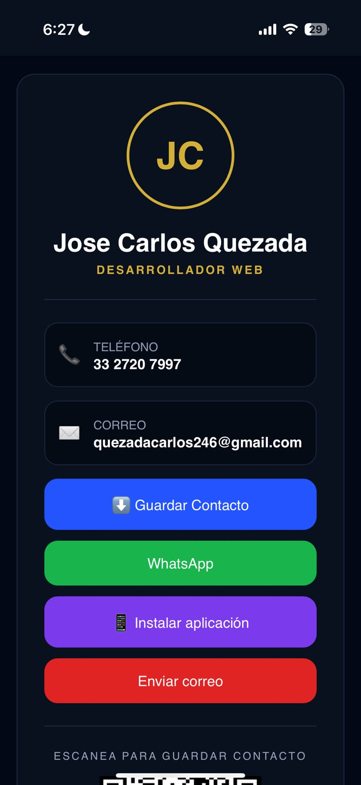
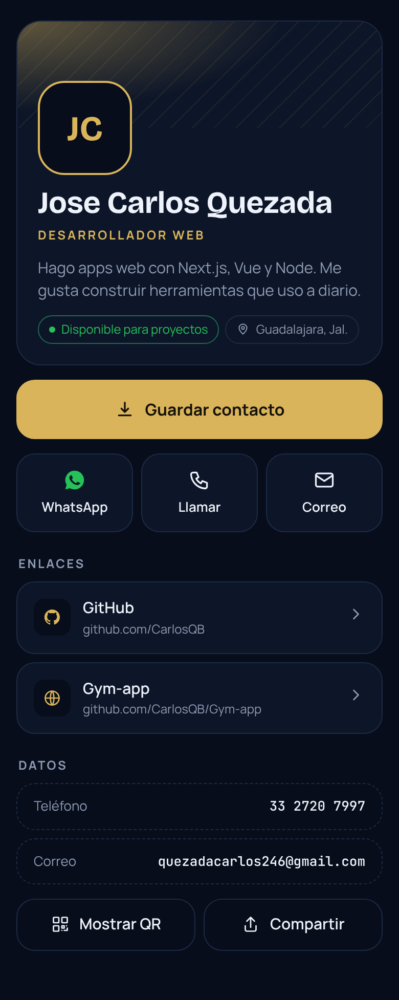
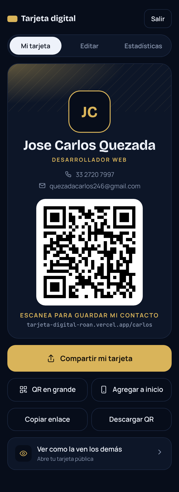
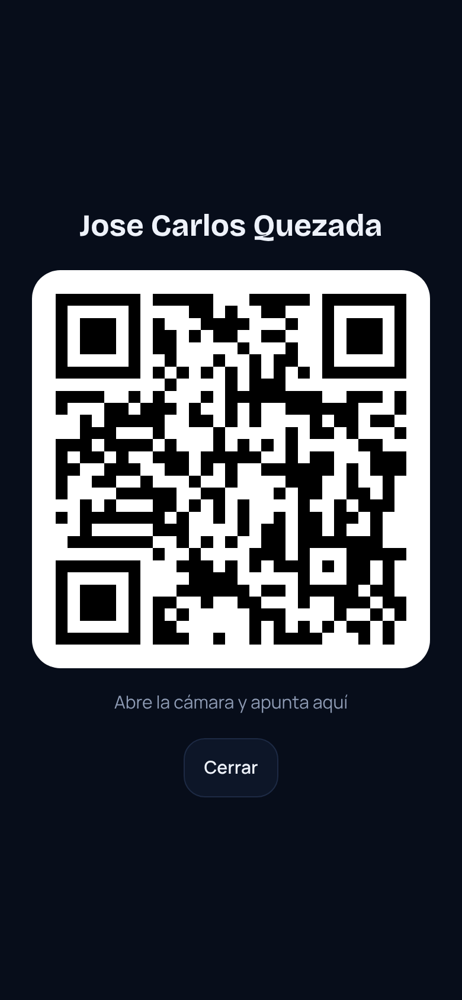
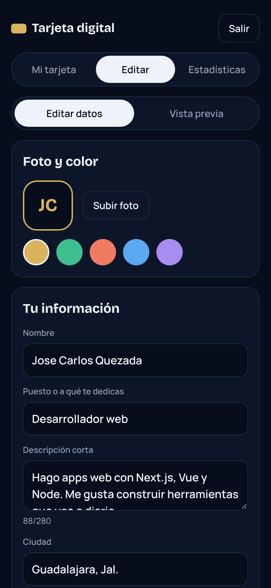
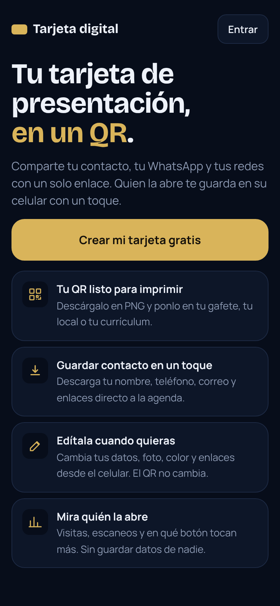
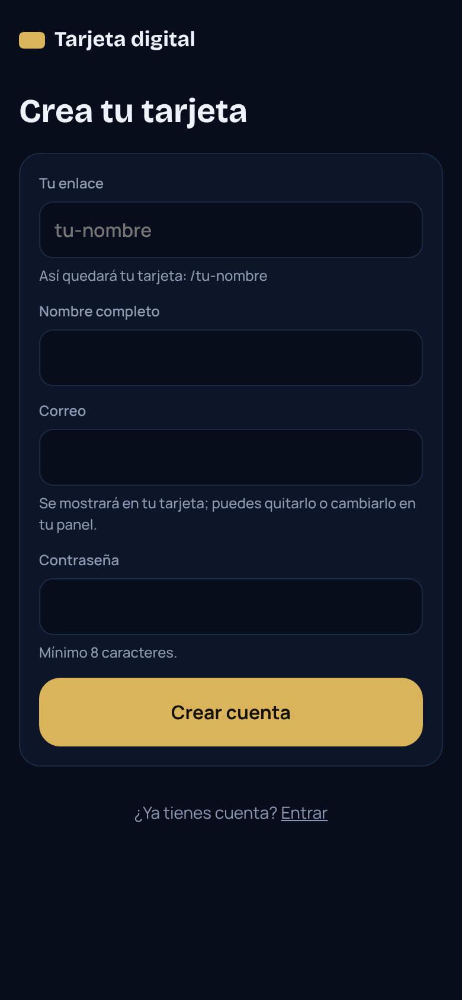

# Tarjeta digital

App web para crear tu tarjeta de presentación digital. Cada persona se registra, arma su tarjeta y la comparte con un enlace o un QR. Quien la abre puede guardar el contacto en su celular, escribir por WhatsApp, llamar, mandar correo o abrir sus redes.

**Demo:** https://tarjeta-digital-roan.vercel.app

## Antes y después

La primera versión era una sola página con mis datos escritos en el código. La versión 2 es una app con cuentas, base de datos, panel para editar y estadísticas.

| Antes (v1) | Después (v2) |
| :---: | :---: |
|  |  |

## Cómo se ve

| Mi tarjeta | QR en grande | Editar |
| :---: | :---: | :---: |
|  |  |  |
| Lo primero que ves al entrar: tu tarjeta lista para mostrar, compartir o agregar a inicio. | Para enseñarlo de frente y que te guarden con la cámara. | Foto, color, datos, contacto y enlaces, con vista previa. |

| Inicio | Registro |
| :---: | :---: |
|  |  |

## Qué hace

- **Registro e inicio de sesión** con correo y contraseña (incluye "olvidé mi contraseña").
- **Una tarjeta por usuario** en su propia dirección: `tu-dominio.com/tu-nombre`.
- **Mi tarjeta** como pantalla principal: QR grande, compartir, agregar a inicio, copiar enlace y descargar el QR.
- **Panel para editar** desde el celular: foto, nombre, puesto, descripción, ciudad, teléfono, WhatsApp, correo, color de acento y enlaces (agregar, ordenar, ocultar, borrar). Con vista previa.
- **Guardar contacto (.vcf)** con foto, puesto, ciudad y enlaces incluidos.
- **QR** para mostrar en pantalla o descargar en PNG para imprimir.
- **Estadísticas**: visitas, escaneos de QR, contactos guardados y en qué botones tocan más (7 o 30 días). No guarda datos de quien visita, solo cuántas veces.
- Diseño pensado primero para celular.

## Tecnologías

- [Next.js 15](https://nextjs.org/) (App Router, TypeScript)
- [Supabase](https://supabase.com/): base de datos Postgres, cuentas de usuario y almacenamiento de fotos
- [Vercel](https://vercel.com/) para publicarla
- `qrcode.react` para los QR

## Cómo correrla en tu computadora

1. Crea un proyecto en Supabase.
2. En Supabase, abre **SQL Editor**, pega el contenido de `supabase/migrations/001_tarjetas.sql` y córrelo.
3. Copia `.env.example` como `.env.local` y llena los valores con los de tu proyecto (Supabase > Project Settings > API).
4. Instala y arranca:

   ```bash
   npm install
   npm run dev
   ```

5. Abre http://localhost:3000, crea tu cuenta y edita tu tarjeta.

## Publicar en Vercel

1. En Vercel, **Add New > Project** e importa este repositorio.
2. Agrega las mismas variables de `.env.example` (con `NEXT_PUBLIC_SITE_URL` igual a tu dominio de Vercel).
3. En Supabase > Authentication > URL Configuration, pon tu dominio de Vercel como **Site URL** y agrega `https://tu-dominio/auth/callback` en **Redirect URLs**.

## Versión anterior

La primera versión (HTML, CSS y JS sin base de datos) está en `legacy/`. El `index.html` de la raíz solo existe para GitHub Pages: redirige los QR viejos a la versión nueva cuando cambias `DESTINO`.

## Autor

José Carlos Quezada Benavides
